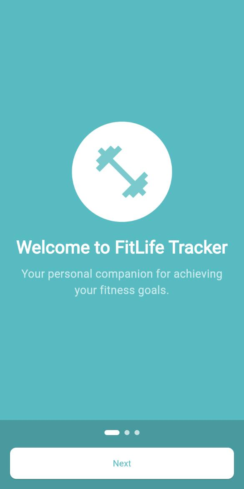
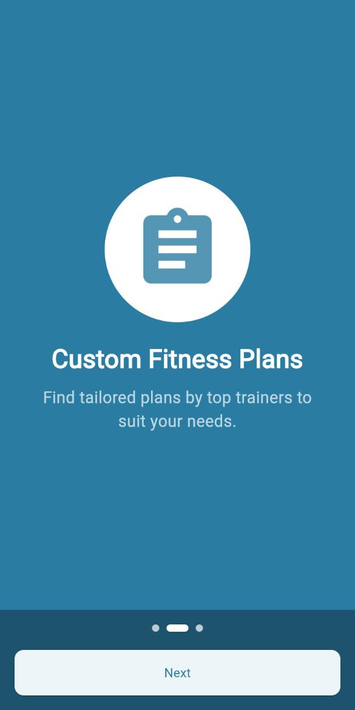
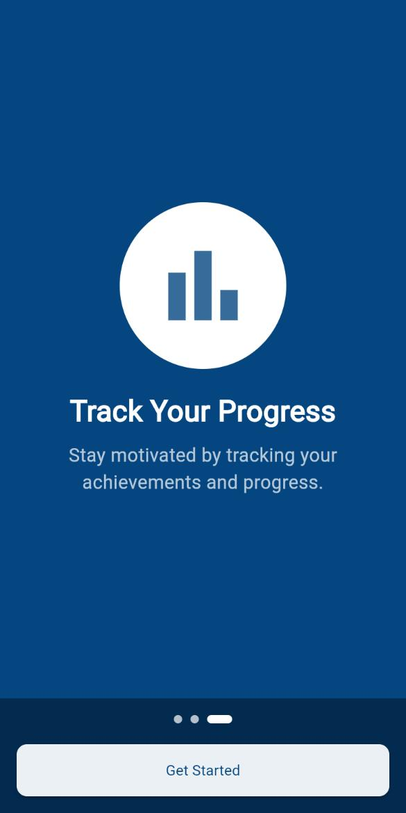
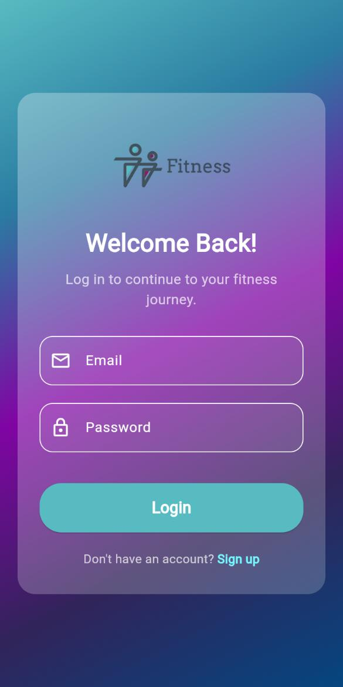
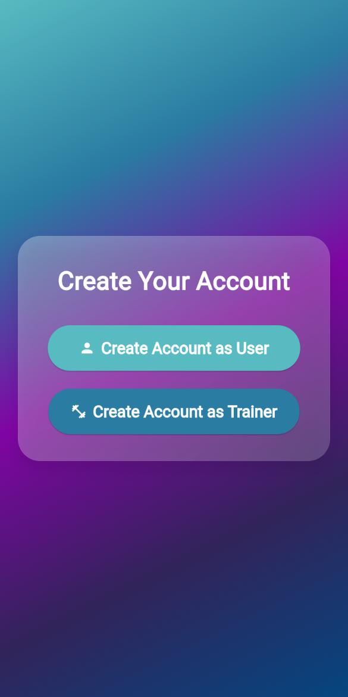
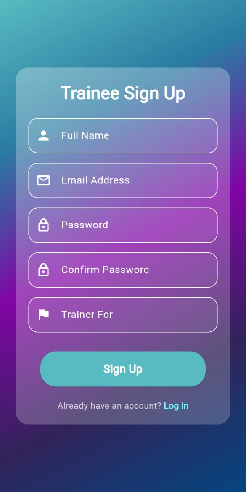
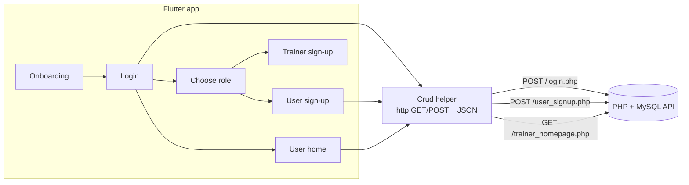

<div align="center">


# FitLife Tracker

**A Flutter fitness app that connects people with trainers: discover plans, track progress, stay motivated.**


</div>

---

## Screenshots

| Onboarding | | | Login | Choose account | Trainer sign-up |
|---|---|---|---|---|---|
|  |  |  |  |  |  |

## Overview

FitLife Tracker is my **Mobile Applications** course project (3rd year, Cyber Security, Ar-Rasheed University). It has two kinds of accounts:

- **Users** browse fitness plans published by trainers and track their progress.
- **Trainers** sign up with their specialty ("Trainer for…") and publish plans.

## Features

- **Animated onboarding** with 3 pages and a page indicator (`smooth_page_indicator`).
- **Glassmorphism UI**: gradient backgrounds, frosted cards, light and dark themes that follow the system.
- **Login** against a REST API, with error snackbars.
- **Role selection**: create an account as a *User* or as a *Trainer*.
- **Form validation** on sign-up (matching passwords, required fields).
- **User home**: a grid of fitness plans loaded from the API, with bottom navigation.

## Architecture



```text
lib/
├── main.dart                # routes and theme
├── configs/
│   ├── crud.dart            # tiny HTTP + JSON helper
│   └── link.dart            # API endpoints
├── screens/                 # onboarding, login
├── signup/                  # role selection, user and trainer sign-up
├── home_screens/            # user home (plans grid)
└── build_widgets/           # shared widgets (error snackbar)
```

## API contract

The app expects a small PHP backend (not included in this repo) that returns JSON:

| Endpoint | Method | Body | Response |
|---|---|---|---|
| `/Fitness/login.php` | POST | `email`, `password` | `{ "status": "success", "user_login": {...} }` |
| `/Fitness/user_signup.php` | POST | `name`, `email`, `password` | `{ "status": "success" }` |
| `/Fitness/trainer_homepage.php` | GET | – | `{ "status": "success", "plan": [ { "Name": "...", "Description": "..." } ] }` |

Set the server address in [`lib/configs/link.dart`](lib/configs/link.dart).

## Run it

```bash
flutter pub get
flutter run            # pick a device: Android, iOS, Chrome, Windows…
```

Without the backend you can still go through onboarding, login and both sign-up screens. The screenshots above were taken that way, from a web build.

## Status and known gaps

This is a course project, kept close to how it was submitted:

- The trainer sign-up form validates its fields but doesn't call the API yet.
- `admin_screens/`, `trainer_screens/` and `user_screens/` are placeholders for planned features.
- Leftovers from the starter template remain: the package name `virtual_bookstore` and `AddEditBookScreen`.

**Fixed later** (see the commit history):

- The home screen crashed when the API was unreachable. It now has a null check.
- `smooth_page_indicator` was declared as a dev dependency even though the app uses it.

## What I learned

- Flutter widgets, navigation with named routes, and animation controllers.
- Talking to a REST backend with `http` and handling JSON and errors.
- Building a consistent visual style across screens.

## Author

**Humam Al-Dhubhani**, Cyber Security, Ar-Rasheed University · [GitHub](https://github.com/humamaldhubhani)

<sub>Released under the [MIT License](LICENSE).</sub>
